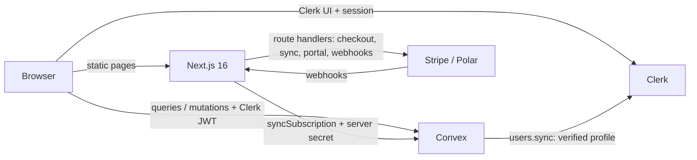
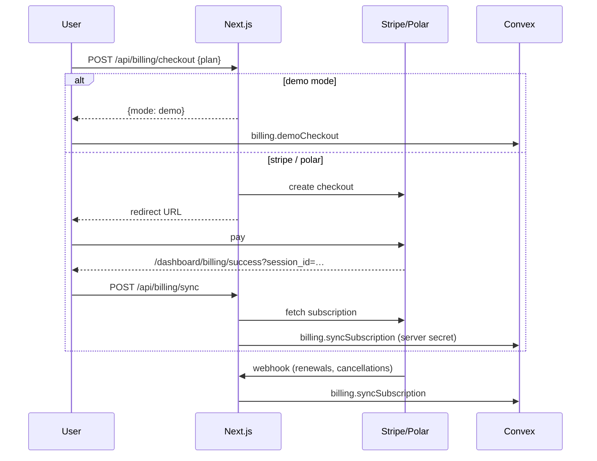

# Architecture

## Overview

- **Marketing pages** are fully static (Cache Components). Auth state in the header is read on
  the client, so nothing on those pages blocks on a request.
- **Signed-in pages** (`/dashboard`, `/admin`) are client components backed by Convex hooks,
  protected by `src/proxy.ts`.
- **Route handlers** in `src/app/api/` talk to payment providers and write to Convex.

## Auth → database

1. Clerk issues its default session JWT (RS256, issuer = the instance's Frontend API URL).
2. `ConvexProviderWithAuth` sends it with every Convex request (`getToken()`, no template).
3. `convex/auth.config.ts` validates it as a `customJwt` provider against the issuer's JWKS.
4. After sign-in the client calls the `users.sync` **action**, which fetches the verified profile
   from the Clerk Backend API (the default token has no email/name) and upserts `users`.

Why an action: email decides admin rights (`ADMIN_EMAILS`), so it must come from Clerk, not the
client.

## Billing

`BILLING_MODE` must match in `.env.local` and on Convex; `npm run setup` keeps them in sync.

## Security model

- Secrets live in `.env.local` / `.env` (gitignored) and Convex env vars. Agents are denied reads of
  `.env*`, `.clerk/` and `.projects/vault/` via `.claude/settings.json`.
- Every Convex function checks identity (`requireUser` / `requireAdmin`) and document ownership.
- Server-to-Convex writes (`billing.syncSubscription`) require `CONVEX_SERVER_SECRET`.
- Webhooks verify signatures (Stripe `constructEventAsync`, Polar `Webhooks`).
- Checkout sync checks the checkout belongs to the signed-in user.
- Analytics accepts an allow-list of event names and truncates fields.

## Files

| Path | Role |
|---|---|
| `convex/schema.ts` | `users`, `subscriptions`, `items`, `events` |
| `convex/auth.config.ts` | Clerk default-token validation |
| `convex/users.ts` | `sync` (action), `upsert`, `me`, `list`, `setRole` |
| `convex/billing.ts` | `syncSubscription`, `demoCheckout`, `demoCancel`, `listSubscriptions` |
| `convex/analytics.ts` | `track`, `overview` |
| `src/components/app/convex-client-provider.tsx` | Clerk → Convex bridge, user sync |
| `src/lib/env.ts` | Feature detection; app degrades to demo instead of crashing |
| `src/lib/billing/*` | Provider adapters |
